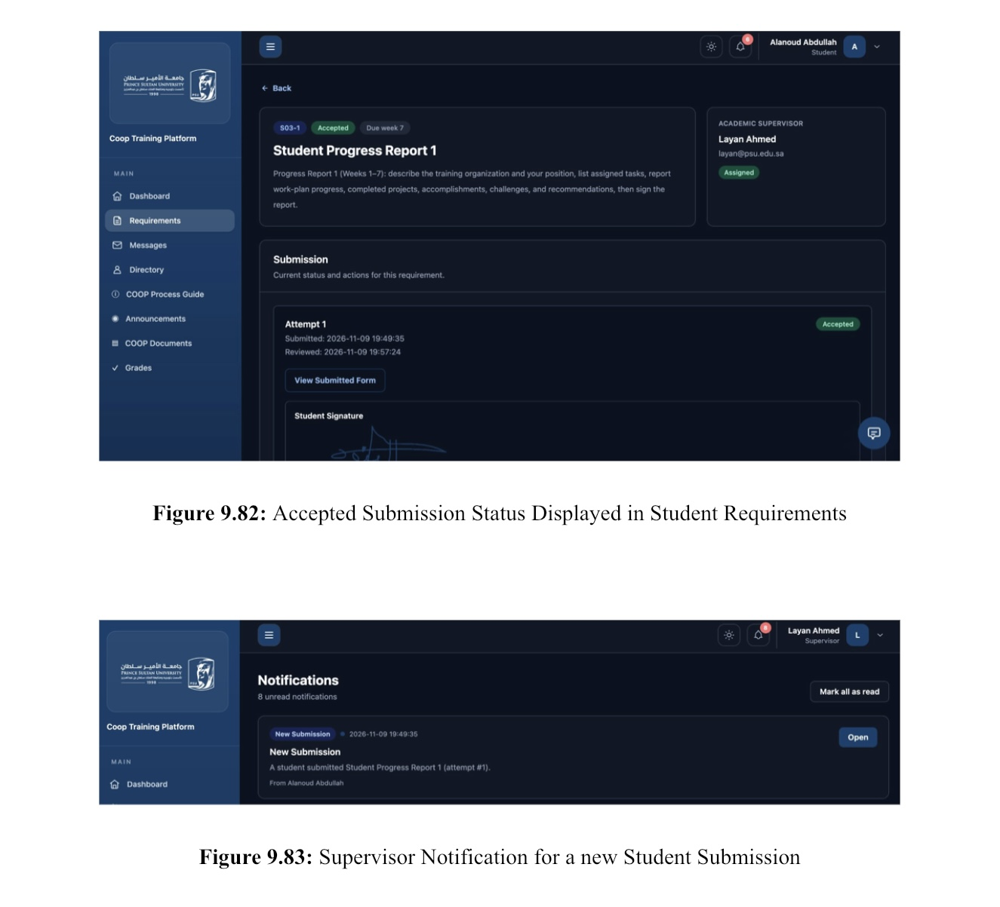
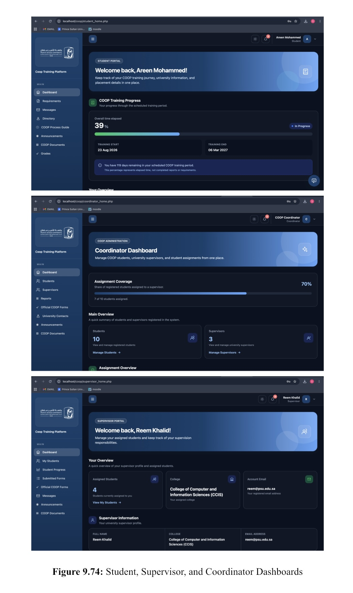
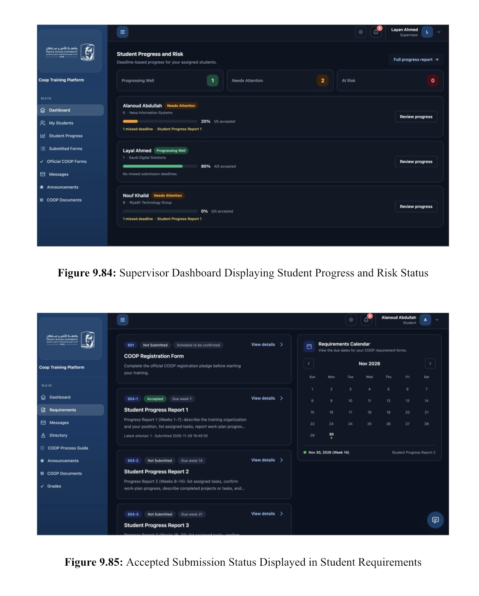
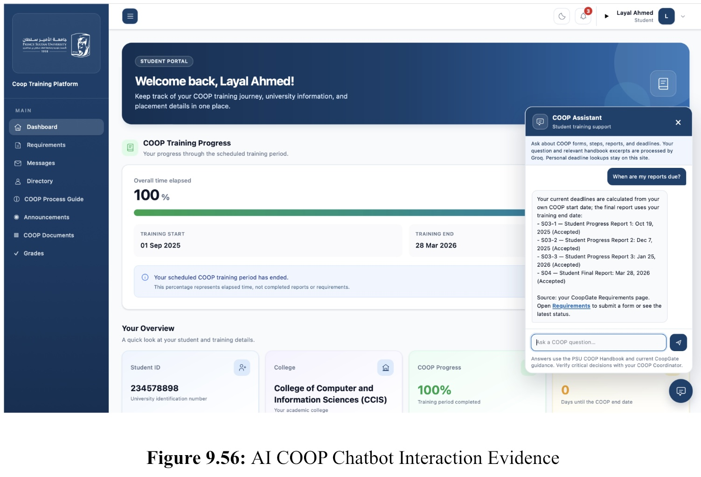
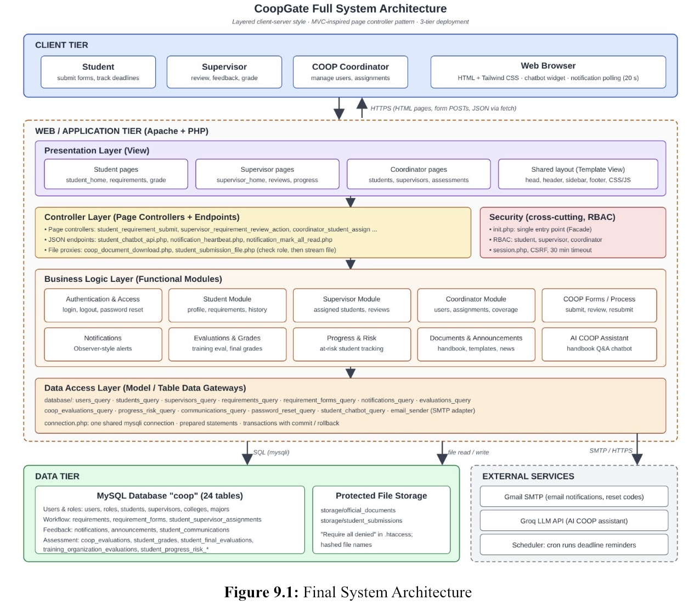

# 🎓 CoopGate
### Smart COOP Training Management Platform

**Senior Project | Prince Sultan University**  
**College of Computer & Information Sciences (CCIS)**

---

## 📌 Project Overview

CoopGate is a web-based Cooperative Training (COOP) Management Platform developed as a senior project at Prince Sultan University.

The platform aims to digitize and streamline the cooperative training process by connecting students, university supervisors, and COOP coordinators through a centralized system.

CoopGate replaces fragmented manual processes with an organized digital environment that simplifies submissions, improves communication, and enables continuous progress monitoring.

---

## 🎯 Problem Statement

Traditional COOP management relies heavily on emails, spreadsheets, and disconnected platforms, creating challenges in:

- Tracking student progress and deadlines.
- Managing document submissions and approvals.
- Maintaining effective communication.
- Monitoring students who require additional attention.
- Organizing evaluations and feedback.

**CoopGate addresses these challenges through a unified digital platform.**

---

## 🚀 Key Features

### 👥 Role-Based Dashboards

Dedicated dashboards for three primary users:

- **Students:** Manage requirements, submit reports, and track progress.
- **University Supervisors:** Review submissions, provide feedback, and evaluate students.
- **COOP Coordinators:** Manage requirements, monitor progress, and oversee training activities.

### 🤖 AI-Powered COOP Assistant

An AI chatbot that helps students find answers to COOP-related questions using the official COOP handbook.

### 📊 Progress & Risk Monitoring

Tracks training progress, identifies missed deadlines, and highlights students who may require additional attention.

### 📄 Digital Submission & Review

Enables students to submit required forms and reports while allowing supervisors to approve, reject, or request revisions.

### 🔔 Notifications & Communication

Provides notifications, announcements, and messaging to improve communication between users.

### 📝 Evaluation & Grading

Supports supervisor evaluations, report grading, and student access to relevant results.

### 🔐 Security & Access Control

Includes authentication, role-based access control, input validation, and security measures designed to protect sensitive information.

---

## 🛠️ Development Methodology

CoopGate was developed using the **Agile Scrum methodology** across three sprints.

### Sprint 1 — System Foundation
- Requirements analysis.
- System architecture and database design.
- Authentication and role-based dashboards.

### Sprint 2 — Core COOP Workflows
- Digital form submissions.
- Supervisor reviews and feedback.
- Notifications and deadline management.

### Sprint 3 — Advanced Features
- AI chatbot integration.
- Progress and risk monitoring.
- Evaluation and grading.
- Communication and reporting enhancements.

---

## 🖥️ System Screenshots

Screenshots of the Student, University Supervisor, and COOP Coordinator dashboards, along with the platform's key features, will be added here.

---

## 🏗️ System Architecture

The project includes system architecture diagrams, database design, use case diagrams, class diagrams, and sequence diagrams documenting the platform's structure and workflows.

---

## 🎓 Senior Project Expo

CoopGate was presented at the Prince Sultan University Senior Project Expo, showcasing the platform's capabilities and demonstrating its potential to improve cooperative training management.

---

## 👩🏻‍💻 Development Team

- Alanood Aldumaiji
- Layal Alsultan
- Nouf Alsalman
- Areen Alruwaitea
- Shaikha Altuwaijri

**Project Supervisor:** Dr. Reem Alsuhaibani

**University:** Prince Sultan University

---

### 💙 CoopGate — From a Scattered Process to a Seamless COOP Journey.

---

## 🖥️ System Screenshots

Explore the key interfaces and functionalities of CoopGate.

### 1. Student, Supervisor & Coordinator Dashboards

### 2. Student Progress & Risk Monitoring

### 3. Submissions & Notifications

### 4. AI-Powered COOP Assistant

### 5. System Architecture

